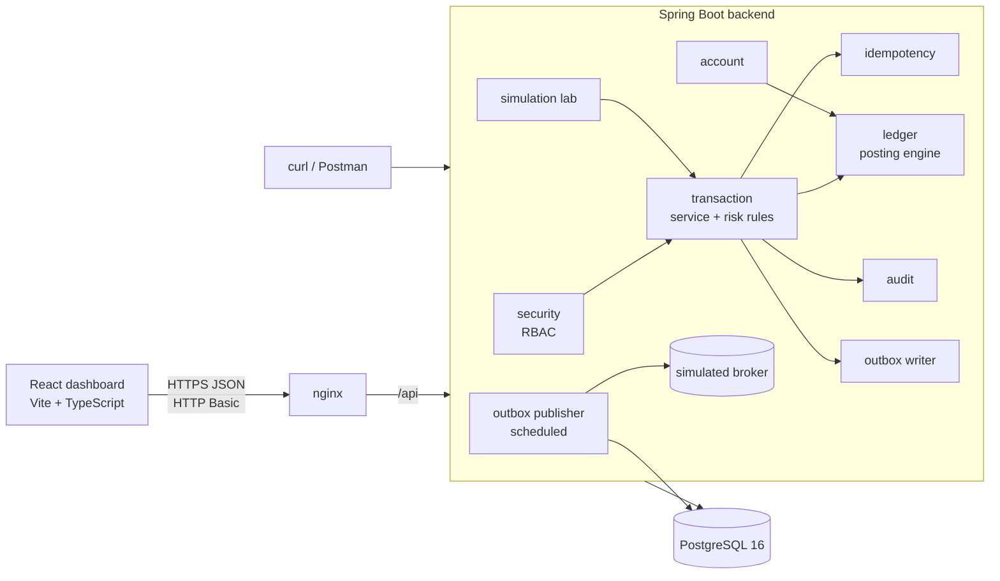
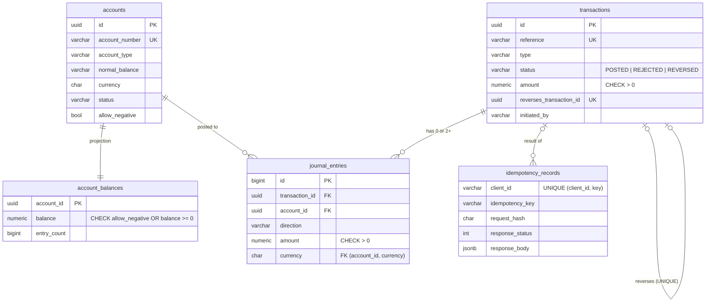
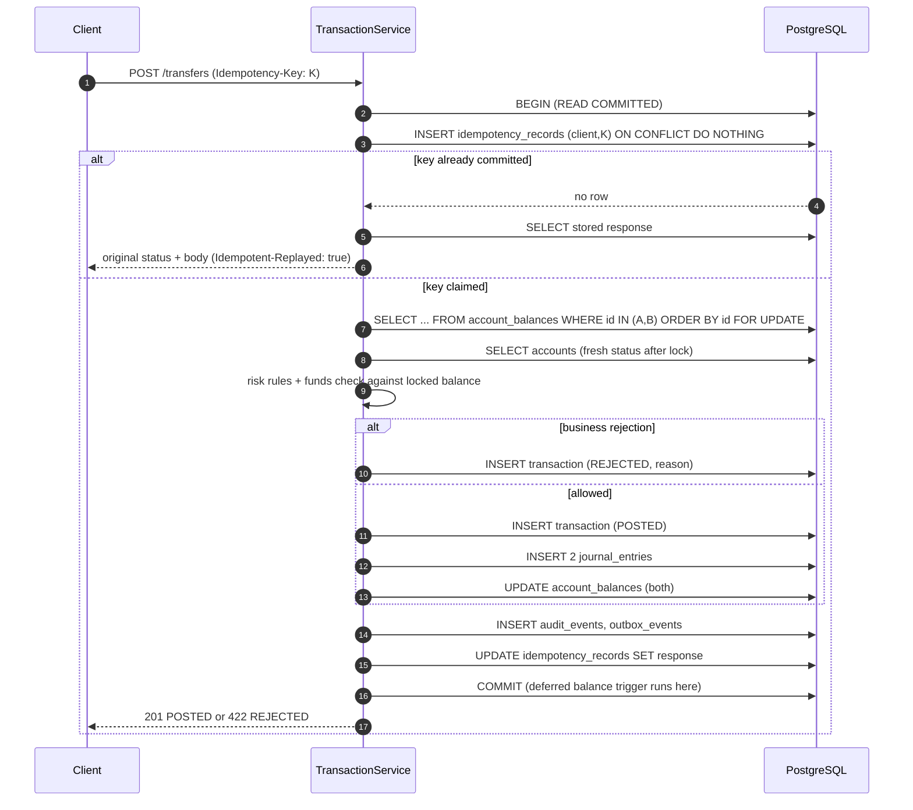
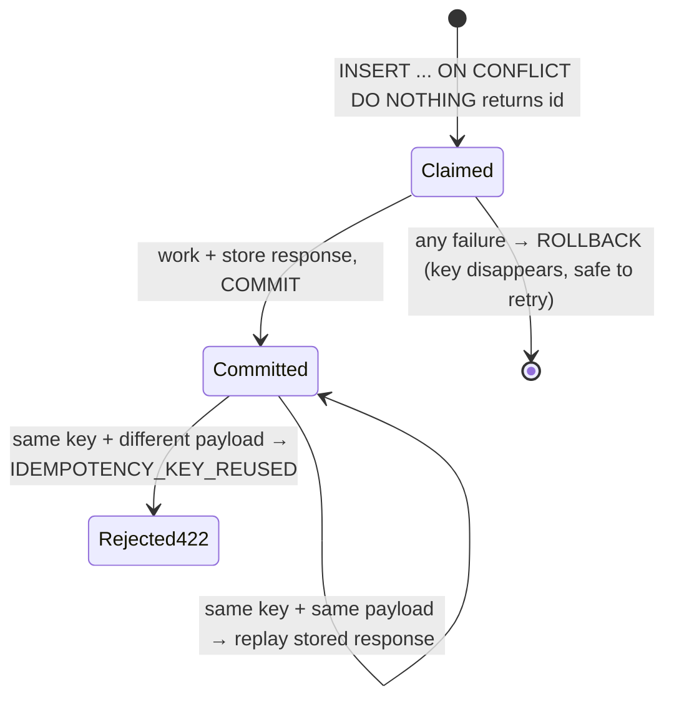
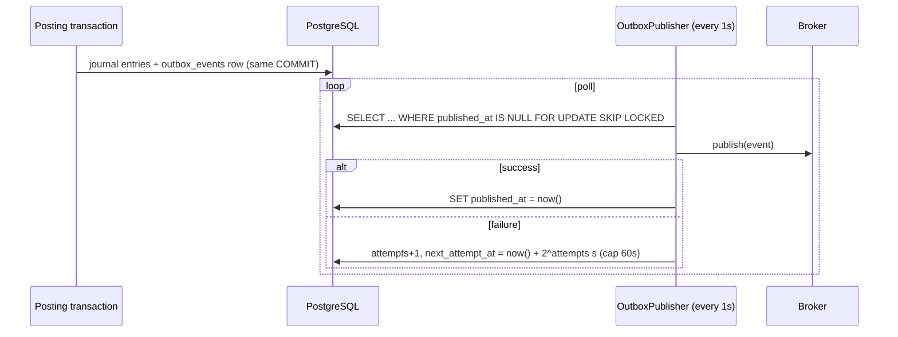

# LedgerGuard architecture

LedgerGuard is a **modular monolith**: one Spring Boot application and one PostgreSQL database, split into packages by business domain. PostgreSQL is the single source of truth, and every financial guarantee is enforced inside a database transaction.

## System

| Package | Responsibility |
| --- | --- |
| `account` | Account lifecycle (ACTIVE ⇄ FROZEN → CLOSED), creation, balance view |
| `ledger` | Journal entries, row locking, posting engine, integrity checks, projection rebuild |
| `transaction` | Deposits, withdrawals, transfers, reversals, risk rules, transaction queries |
| `idempotency` | Persistent idempotency keys with request fingerprints |
| `audit` | Append-only audit trail written in the same DB transaction as the action |
| `outbox` | Transactional outbox, publisher with backoff, simulated broker and idempotent consumer |
| `security` | HTTP Basic, five demo roles, server-side authorization |
| `simulation` | Simulation Lab scenarios and per-thread failure injection (disabled by default) |
| `reporting` | Dashboard figures computed from live data |
| `common` | Money rules, Problem Details errors, correlation IDs, transaction runner with retry |

Controllers hold no financial logic. They validate input, take the principal, and call a service.

## Accounting model

The books are kept **from the institution's point of view**:

| Account | Type | Normal balance | Increases with |
| --- | --- | --- | --- |
| Customer cash account | LIABILITY (money owed to the customer) | CREDIT | credit |
| `SYS-CLEARING-USD` (simulated external clearing) | ASSET | DEBIT | debit |

| Operation | Debit | Credit |
| --- | --- | --- |
| Deposit $X | Clearing (asset ↑) | Customer (liability ↑) |
| Withdrawal $X | Customer (liability ↓) | Clearing (asset ↓) |
| Transfer $X A→B | A (liability ↓) | B (liability ↑) |
| Reversal | every original entry with its direction flipped | |

Debit and credit are not "minus" and "plus". `LockedBalance.deltaFor(leg)` turns a leg into a signed change using the account's normal balance.

## Data model

Also: `audit_events` (append-only) and `outbox_events` (with a partial index on unpublished rows).

## Invariants and where each is enforced

| # | Invariant | Application | Database |
| --- | --- | --- | --- |
| 1 | Every journal transaction balances | `PostingEngine.requireBalanced` | Deferred constraint trigger `trg_journal_balanced` (checked at COMMIT) |
| 2 | Entries reference valid accounts in the same currency | lock query validates existence | FK `(account_id, currency) → accounts(id, currency)` |
| 3 | Amounts are positive | `Money.requireValidAmount` | `CHECK (amount > 0)` on entries and transactions |
| 4 | Unsupported currencies rejected | `Money.requireSupportedCurrency` | `CHECK (currency IN ('USD'))` |
| 5 | Posted entries are immutable | no update/delete code paths | `BEFORE UPDATE/DELETE/TRUNCATE` trigger |
| 6 | Corrections are new entries | reversal service | `reverses_transaction_id` link + status trigger |
| 7 | Projections agree with the ledger | updated in the same transaction | integrity check + rebuild endpoint |
| 8 | No unauthorized negative balance | funds check under row lock | `CHECK (allow_negative OR balance >= 0)` |
| 9 | No partial transfer | one DB transaction per operation | atomic commit + deferred balance trigger |
| 10 | No duplicate idempotent effect | idempotency claim in same transaction | `UNIQUE (client_id, idempotency_key)` |
| — | One reversal per transaction | row lock on the original | `UNIQUE (reverses_transaction_id)` |
| — | Only POSTED → REVERSED transitions | service checks | `trg_transactions_guard_update` |

`GET /api/v1/ledger/integrity` re-verifies 1, 7, 8, 9 and 10 from the ledger in one REPEATABLE READ snapshot.

## Transfer: transaction boundary and locking

**Locking strategy.** This is pessimistic, row-level locking on `account_balances`, which is the row every posting must update anyway.
- Locks are taken in `account_id` order. A→B and B→A therefore both lock the same row first, so they queue instead of deadlocking.
- Account status is re-read after the lock is held. Status changes take the same lock, so a freeze cannot interleave with a posting.
- Transient failures (deadlock `40P01`, serialization failure `40001`) are retried up to 3 times by `TransactionRunner`. This is safe only because a failed attempt rolls back completely, idempotency claim included.
- Java `synchronized` is never used for consistency, because it would not protect a second application instance.

**Trade-off: the hot clearing account.** Every deposit and withdrawal locks `SYS-CLEARING-USD`, so they serialize on that one row. That is acceptable for a demo. Production designs shard clearing accounts or post to them asynchronously. See `BACKLOG.md`.

## Idempotency lifecycle

Concurrent requests with the same key: PostgreSQL makes the second `INSERT` **wait** on the first transaction's uncommitted unique-index entry. If the first commits, the second sees the row and replays. If the first rolls back, the second inserts and does the work. No "in progress" state ever needs cleaning up.

Keys are scoped per authenticated user (`client_id`). Business rejections are stored and replayed too: a retry returns the original outcome and is not re-evaluated.

## Transactional outbox

- The ledger and its event can never disagree: both commit together or neither does.
- Posting never waits for the broker. A broker outage only delays events.
- Delivery is **at-least-once**: the publisher can crash after publishing but before marking the row. Consumers de-duplicate by `eventId`. The demo consumer de-duplicates in memory; a real one would persist processed IDs. End-to-end exactly-once is **not** claimed.
- `SKIP LOCKED` lets several publisher instances share the table without double-claiming rows.

## Security model

| Role | Can |
| --- | --- |
| VIEWER | Read accounts, transactions, ledger, reports, integrity |
| OPERATOR | + create accounts, post deposits/withdrawals/transfers, run simulations |
| APPROVER | + reverse transactions (never their own: separation of duties) |
| AUDITOR | + read the audit trail |
| ADMIN | All of the above + freeze/unfreeze/close accounts, rebuild projections, actuator metrics |

- Authentication is stateless HTTP Basic with BCrypt-hashed demo users. The shared password comes from the environment and is never committed.
- CSRF protection is disabled. The API issues no cookies, and a cross-site page cannot attach an `Authorization` header.
- Errors use RFC 9457 Problem Details and never include SQL or stack traces.
- Every response carries `X-Correlation-Id`, which is stored on transactions, audit events and outbox events.

## Failure behaviour

| Failure | Result |
| --- | --- |
| Exception after the first journal entry | Full rollback: no entries, no balance change, no transaction row, no outbox event, no idempotency key |
| Process killed mid-transaction | PostgreSQL rolls back the open transaction; the client retries with the same key |
| Deadlock / serialization failure | Retried up to 3 times, then 503 `RETRY_LATER` (nothing committed) |
| Broker down | Posting unaffected; events stay pending and are retried with backoff |
| Projection drift (e.g. a manual SQL edit) | Integrity check reports it; `POST /ledger/projections/rebuild` recomputes from the ledger under locks |
