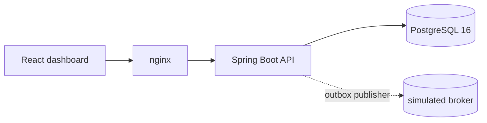

# LedgerGuard

**Financial integrity by design.** LedgerGuard is a double-entry ledger and transaction-processing service. It keeps balances correct under concurrent requests, duplicate submissions, mid-transaction failures and broker outages, and it proves each of those claims with automated tests against a real PostgreSQL database.

> LedgerGuard is an educational, portfolio project. It uses **synthetic data only**. It does not process real money, does not connect to any bank or payment network, and is not a regulated financial service.


## Why it exists

Moving $250 from one account to another is easy until:
- two withdrawals of $800 and $600 hit a $1,000 account at the same moment;
- a client times out and retries the same transfer 100 times;
- the process crashes after debiting one account but before crediting the other.

LedgerGuard shows how a financial system prevents each of these failures, using database transactions, row-level locking, persistent idempotency, a double-entry ledger and a transactional outbox.

## Key features

- **Genuine double-entry ledger.** Every posting writes balanced debit and credit entries. A deferred PostgreSQL trigger rejects any unbalanced journal at COMMIT, even one written by raw SQL.
- **Concurrency-safe posting.** `SELECT … FOR UPDATE` on balance rows, taken in `account_id` order to avoid deadlocks, with automatic retry of transient failures.
- **Persistent idempotency.** Keys are claimed with a unique constraint in the *same* transaction as the money movement. In tests, 100 concurrent duplicates produce one transfer.
- **Atomic operations.** The transaction header, journal entries, balance projections, audit record, outbox event and idempotency result all commit together or not at all.
- **Reversals, never edits.** Posted entries are append-only (enforced by a trigger). Corrections are compensating journal transactions, at most one per original, with separation of duties.
- **Integrity verification.** One endpoint recomputes every balance from the ledger and checks every invariant inside one consistent snapshot. Projections can be rebuilt from the ledger.
- **Transactional outbox.** Events commit with the ledger change and are published with retry and backoff (at-least-once, consumer de-duplication).
- **RBAC.** Viewer, operator, approver, auditor and admin roles, enforced server-side. Errors are RFC 9457 Problem Details, and every request carries a correlation ID.
- **Simulation Lab.** A UI that runs the race conditions live (concurrent withdrawals, duplicate submissions, mid-posting failure, broker outage) and shows what actually happened.

## Architecture

A modular monolith (Spring Boot 3.5, Java 21) on PostgreSQL 16, with a React + TypeScript operations dashboard. See [ARCHITECTURE.md](ARCHITECTURE.md) for diagrams, the accounting model, the invariant matrix, transaction boundaries, the locking strategy and the outbox design.



| Layer | Technology |
| --- | --- |
| Backend | Java 21, Spring Boot 3.5 (Web, Security, Validation, JDBC, Actuator), Flyway, springdoc-openapi |
| Database | PostgreSQL 16: constraints, deferred triggers, row locks, partial indexes |
| Frontend | React 19, TypeScript, Vite, Tailwind CSS, Recharts, lucide-react |
| Testing | JUnit 5, AssertJ, Spring MockMvc, Testcontainers (real PostgreSQL), Vitest, SQL-level concurrency script |
| Ops | Docker, Docker Compose, GitHub Actions, Micrometer/Prometheus endpoint, structured (ECS) logs |

## Quick start (Docker)

```bash
cp .env.example .env          # then set your own passwords
docker compose up --build
```

- Dashboard: <http://localhost:3000>. Sign in as `operator`, `approver`, `viewer`, `auditor` or `admin`, using `LEDGERGUARD_DEMO_PASSWORD` from your `.env`.
- API docs: <http://localhost:8080/swagger-ui.html>
- Health: <http://localhost:8080/actuator/health>

## Local development

```bash
# Database
docker compose up -d postgres

# Backend (Java 21, Maven)
cd backend
export LEDGERGUARD_DB_PASSWORD=... LEDGERGUARD_DEMO_PASSWORD=... LEDGERGUARD_SIMULATION_ENABLED=true
mvn spring-boot:run

# Frontend (Node 22)
cd frontend && npm install && npm run dev     # http://localhost:5173, proxies /api to :8080
```

## API

See [docs/api-examples.md](docs/api-examples.md) for curl examples of every endpoint. Main endpoints:

| Method | Path | Role |
| --- | --- | --- |
| POST | `/api/v1/accounts` | OPERATOR |
| GET | `/api/v1/accounts`, `/{id}`, `/{id}/balance`, `/{id}/entries` | VIEWER |
| PATCH | `/api/v1/accounts/{id}/status` | ADMIN |
| POST | `/api/v1/transactions/deposits`, `/withdrawals`, `/transfers` (Idempotency-Key) | OPERATOR |
| POST | `/api/v1/transactions/{id}/reversals` (Idempotency-Key) | APPROVER |
| GET | `/api/v1/transactions`, `/api/v1/transactions/{id}` | VIEWER |
| GET | `/api/v1/ledger/entries`, `/api/v1/ledger/integrity` | VIEWER |
| POST | `/api/v1/ledger/projections/rebuild` | ADMIN |
| GET | `/api/v1/reports/overview` | VIEWER |
| GET | `/api/v1/audit-events` | AUDITOR, ADMIN |
| POST | `/api/v1/simulations/*` (only when enabled) | OPERATOR |

**Response semantics.** `201` means posted. `422` means a business rejection, which is recorded with a reason. A retry with the same key returns the original response with `Idempotent-Replayed: true`. Reusing a key with a different payload returns `422 IDEMPOTENCY_KEY_REUSED`.

## Testing

```bash
cd backend && mvn verify                 # unit + integration tests (needs Docker for Testcontainers)
cd frontend && npm run lint && npm run typecheck && npm test && npm run build
PGHOST=localhost PGUSER=postgres PGPASSWORD=... ./scripts/verify-db-concurrency.sh   # SQL-level proof (disposable DB)
```

| Suite | What it proves |
| --- | --- |
| `ConcurrencyIntegrationTest` | $800/$600 race on $1,000 (×5); 50 concurrent withdrawals never overdraw; 120 random transfers preserve total value; opposite-direction transfers don't deadlock |
| `IdempotencyIntegrationTest` | 100 concurrent duplicates produce 1 transfer; replay over HTTP; key reuse rejected; per-client scope; rejections replayed |
| `RollbackIntegrationTest` | Failure after the first entry leaves no trace; the same key can be retried |
| `DatabaseConstraintIntegrationTest` | Unbalanced journal rejected at COMMIT; entries and audit append-only; negative balances and illegal status changes blocked |
| `ReversalIntegrationTest` | Compensating entries; reversal at most once (also under 10-way concurrency); separation of duties |
| `SecurityIntegrationTest` | 401/403 per role, Problem Details, correlation IDs, validation errors |
| `OutboxIntegrationTest` | Broker outage does not affect posting; events recover; duplicates ignored |
| `IntegrityIntegrationTest` | Projection drift detected and rebuilt from the ledger |
| `SimulationIntegrationTest` | All four Simulation Lab scenarios end-to-end over HTTP |

### Verification status

| Check | Where | Status |
| --- | --- | --- |
| Java compile, 31 unit tests, 61 Testcontainers integration tests (92 total) | CI `backend` job | **Passed**: 0 failures, 0 skipped ([run 45954950981](https://github.com/kevinnngoo/ledgerguard/actions/runs/45954950981)) |
| SQL-level locking and idempotency proof | CI `database` job + local PostgreSQL 16 | **Passed** (results in [docs/case-studies.md](docs/case-studies.md)) |
| Frontend lint, typecheck, unit tests, build | CI `frontend` job | **Passed** |
| Docker images build | CI `docker` job | **Passed** |
| Full stack via `docker compose up` (manual smoke test) | your machine | Not yet run |

## Measured results

See [docs/case-studies.md](docs/case-studies.md). Headline (PostgreSQL 16, 2 vCPU dev container, 25 concurrent sessions, $100 withdrawals from $1,000):

| Strategy | Approved | Paid out |
| --- | --- | --- |
| Read-check-write without locks | 25 / 25 | $2,500 |
| `SELECT … FOR UPDATE` | 10 / 25 | $1,000 |

Load tests (k6) and query-plan benchmarks have **not** been run yet; no throughput or latency figures are claimed.

## Known limitations

- Single currency (USD). No FX, no multi-currency journals.
- Reconciliation against external CSV records, exception management, manual-approval workflow and k6 load tests are not implemented yet (see [ROADMAP.md](ROADMAP.md)).
- Demo authentication (HTTP Basic, five shared-password users). A real deployment would use an identity provider.
- The outbox broker and its de-duplicating consumer are in-process and in-memory. Kafka is deliberately deferred ([ADR 0006](docs/adr/0006-transactional-outbox-and-kafka-timing.md)).
- Every deposit and withdrawal locks the single clearing account, which is a throughput bottleneck by design for now.
- The audit trail is append-only through the application, but it is not tamper-proof against a database superuser.
- Idempotency records are never purged.

## Documentation map

- [ARCHITECTURE.md](ARCHITECTURE.md): diagrams, invariants, locking, idempotency, outbox, security
- [docs/adr/](docs/adr): architecture decision records
- [docs/case-studies.md](docs/case-studies.md): measured engineering case studies
- [LEARNING_GUIDE.md](LEARNING_GUIDE.md): every concept mapped to the code, with exercises
- [INTERVIEW_GUIDE.md](INTERVIEW_GUIDE.md): how to explain the system, with hard questions
- [ROADMAP.md](ROADMAP.md), [BACKLOG.md](BACKLOG.md), [CLAUDE.md](CLAUDE.md)

## How this was built

LedgerGuard was implemented with substantial AI assistance (Claude) from a detailed specification written by the author. The author owns the design goals and the verification standard. The author also commits to reviewing the code, running the tests, and being able to explain every decision; the learning and interview guides exist for exactly that purpose.
